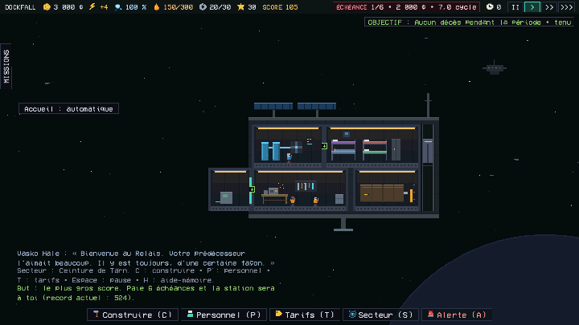

# Dockfall

**A free roguelite space station management game in pixel art, for Windows.**
*Un jeu gratuit de gestion de station spatiale roguelite en pixel art, pour Windows.*

You take over the Relay, a refueling station lost in the asteroid belt, and the debt that comes with it. Refuel ships, repair their hulls, keep your crew alive and pay the Company, deadline after deadline. Buy the station after six deadlines, then keep going as owner for the highest score on the world leaderboard.

- **Set your prices** for docking, fuel, repairs, trade and care. Too expensive, and ships fly to Vega, the rival post.
- **Build and upgrade** docks, workshop, oxygen recycler, quarters, market, security, reactor. Modules affect their neighbours.
- **Lead a crew** of four species, each with a job, a personality and a rarity.
- **Take the hits**: fires, pirate boardings, inspections, epidemics, solar storms.
- **Every run is different**: 3 sectors, 3 starting stations, conditions, challenges, a daily concession and a mystery to uncover.

Free • Windows 10/11 • English and French • automatic updates

## ▶ [Download, wiki and leaderboard: dockfall.netlify.app](https://dockfall.netlify.app/en/)

[Version française](https://dockfall.netlify.app/) • [Press kit](https://dockfall.netlify.app/en/#presse)

---

*This repository holds the game's website.*
